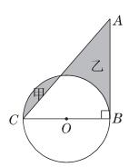

# Mathematics (Grade 6)

**ID**: d0757bbd
**难度**: medium_hard
**题型**: short_answer

## 题目
如图，三角形ABC是直角三角形，阴影部分面积乙比甲大75cm$^{2}$，BC长20cm，求AB的长是多少厘米？

## 解答

**答案**: 23.2

1. Step1:计算半圆的半径，因为BC长20cm，它是半圆的直径，所以半径为20÷2=10厘米
2. Step2:根据圆的面积公式S = πr²，计算半圆的面积为3.14×10×10÷2 = 157平方厘米
3. Step3:由于阴影部分乙比甲大75平方厘米，所以三角形ABC的面积比半圆的面积大75平方厘米，那么三角形ABC的面积为157 + 75 = 232平方厘米
4. Step4:根据三角形面积公式S = 底×高÷2，已知BC为底是20厘米，求高AB，所以AB的长为232×2÷20 = 23.2厘米

## 知识点

**知识点**:
  - 组合图形的面积

---
