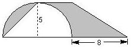

# Mathematics (Grade 6)

**ID**: d1b8860a
**难度**: medium_hard
**题型**: short_answer

## 题目
求下面阴影部分的面积．（单位：厘米）

## 解答

**答案**: 32.5

1. Step1:根据解析2，将左边阴影部分翻转平移补到右边，构成一个梯形
2. Step2:确定梯形的上底为5厘米，下底为8厘米，高为5厘米
3. Step3:根据梯形面积公式S=(a + b)×h÷2（其中a为上底，b为下底，h为高），代入数值计算，即(8 + 5)×5÷2
4. Step4:先计算8 + 5 = 13
5. Step5:再计算13×5 = 65
6. Step6:最后计算65÷2 = 32.5，得到阴影部分面积为32.5平方厘米

## 知识点

**知识点**:
  - 圆与组合图形

---
