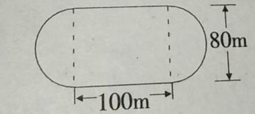

# Mathematics (Grade 6)

**ID**: d22f1772
**难度**: medium_hard
**题型**: short_answer

## 题目
求下列图形的周长和面积。

 80m
 100m

## 解答

**答案**: 451.2, 13024

1. Step1:分析图形可知，其周长由两个半圆（可拼成一个圆）的周长和两条长方形的长组成。圆的直径为80米，根据圆的周长公式C = πd（d为直径），可得圆的周长为3.14×80米，长方形的长为100米，两条长为100×2米，所以周长为3.14×80 + 100×2 = 451.2米
2. Step2:分析图形面积可知，其由一个圆和一个长方形组成。圆的直径为80米，则半径为80÷2 = 40米，根据圆的面积公式S = πr²（r为半径），可得圆的面积为3.14×40×40 = 5024平方米
3. Step3:长方形的长为100米，宽为80米，根据长方形面积公式S = a×b（a为长，b为宽），可得长方形面积为80×100 = 8000平方米
4. Step4:将圆的面积和长方形的面积相加，可得图形总面积为5024 + 8000 = 13024平方米

## 知识点

**知识点**:
  - --

---
