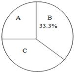

# Mathematics (Grade 6)

**ID**: d3d27060
**难度**: medium_hard
**题型**: short_answer

## 题目
观察图，并回答问题：如果扇形A代表90公顷麦田，那么扇形C代表多少公顷麦田？

## 解答

**答案**: 150.12

1. Step1:观察图形可知扇形A的圆心角是90度，整个圆的圆心角是360度，所以扇形A占整个扇形面积的比例为90÷360 = $rac{1}{4}$
2. Step2:已知扇形A代表90公顷麦田，根据扇形A占比$rac{1}{4}$，可求出整个扇形的面积为90÷$rac{1}{4}$ = 360公顷
3. Step3:计算扇形C占整个面积的比例为1 - $rac{1}{4}$ - 33.3% = 41.7%
4. Step4:用整个扇形的面积360公顷乘扇形C所占的比例41.7%，即360×41.7% = 150.12公顷，得到扇形C代表的麦田面积

## 知识点

**知识点**:
  - 扇形统计图

---
