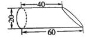

# Mathematics (Grade 6)

**ID**: d451d628
**难度**: medium_hard
**题型**: short_answer

## 题目
下图是圆柱形木料被削去一半后的形状，计算出它的体积。（单位：cm）

## 解答

**答案**: 15700

1. Step1:计算圆柱底面半径，20÷2 = 10（厘米）
2. Step2:计算高40厘米的圆柱体积，3.14×10²×40 = 12560（立方厘米）
3. Step3:计算高为60 - 40 = 20厘米圆柱体积的一半，3.14×10²×（60 - 40）÷2 = 314×20÷2 = 3140（立方厘米）
4. Step4:将两部分体积相加，12560 + 3140 = 15700（立方厘米）

## 知识点

**知识点**:
  - 小学数学;图形与几何;立体图形;组合体的体积

---
