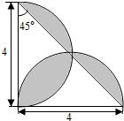

# Mathematics (Grade 6)

**ID**: d81f2ed2
**难度**: medium_hard
**题型**: short_answer

## 题目
求图中阴影部分的面积．（单位：厘米）

## 解答

**答案**: 4.56

1. Step1:计算以4为直径的圆的半径，4÷2 = 2厘米
2. Step2:根据圆的面积公式S = πr²，计算圆的面积，3.14×2² = 3.14×4 = 12.56平方厘米
3. Step3:计算三角形的面积，三角形的底和高都是4厘米，根据三角形面积公式S = 底×高÷2，可得4×4÷2 = 8平方厘米
4. Step4:根据阴影部分面积 = 圆的面积 - 三角形的面积，计算阴影部分面积，12.56 - 8 = 4.56平方厘米

## 知识点

**知识点**:
  - 组合图形的面积；三角形的周长和面积；圆、圆环的面积．

---
