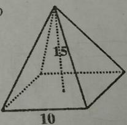

# Mathematics (Grade 6)

**ID**: d86273d5
**难度**: medium_hard
**题型**: short_answer

## 题目
计算圆锥体积的公式"
 $V=\frac{1}{3}Sh$
  "也适用于棱锥。如底面是三角形的叫做三棱锥，底面是四边形的叫做四棱锥、有一个四棱锥的底面是正方形（如图所示），这个四棱锥的体积是多少立方厘米？ （单位：厘米）

 15
 10

## 解答

**答案**: 100cm^{3}

1. Step1:明确四棱锥底面是正方形，边长为10厘米，根据正方形面积公式S = a×a（a为边长），可得底面面积S = 10×10 = 100平方厘米
2. Step2:已知四棱锥的高h = 15厘米
3. Step3:根据四棱锥体积公式V = 1/3Sh，将S = 100平方厘米，h = 15厘米代入，可得V = 1/3×100×15 = 500立方厘米

## 知识点

**知识点**:
  - 

---
