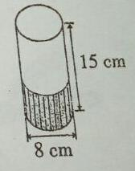

# Mathematics (Grade 6)

**ID**: d8918093
**难度**: medium_hard
**题型**: short_answer

## 题目
李欣做了一个圆柱形的笔筒，她把笔筒侧面的
 $\frac{2}{5}$
  涂上了颜色.涂色部分的面积约是多少平方厘米？（得数保留整数）

 8cm
 15cm

## 解答

**答案**: 170

1. Step1:根据圆柱侧面积公式 S = 底面圆周长×高，先求底面圆周长，由圆的周长公式 C = πd（d 为直径），已知直径为 8cm，可得底面圆周长为 3.14×8
2. Step2:已知圆柱高为 15cm，根据圆柱侧面积公式，可得圆柱侧面积为 3.14×8×15
3. Step3:因为笔筒侧面的 2/5 涂上颜色，所以涂色部分面积为圆柱侧面积乘以 2/5，即 3.14×8×15×2/5
4. Step4:计算 3.14×8×15×2/5 的结果，并按照要求保留整数得到答案

## 知识点

**知识点**:
  - 

---
