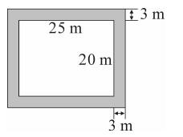

# Mathematics (Grade 6)

**ID**: d8debbf4
**难度**: medium_hard
**题型**: short_answer

## 题目
有一个长25米、宽20米的花坛，如果在这个花坛的四周修3米宽的小路（如下图），小路的面积是多少平方米？

## 解答

**答案**: 306

1. Step1:计算外面长方形的长，25 + 3 + 3 = 31（米）
2. Step2:计算外面长方形的宽，20 + 3 + 3 = 26（米）
3. Step3:计算外面长方形的面积，31×26 = 806（平方米）
4. Step4:计算花坛的面积，25×20 = 500（平方米）
5. Step5:计算小路的面积，806 - 500 = 306（平方米）

## 知识点

**知识点**:
  - 整数、分数、小数、百分数四则混合运算;长方形与正方形的面积

---
