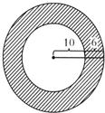

# Mathematics (Grade 6)

**ID**: dc7ecf15
**难度**: medium_hard
**题型**: short_answer

## 题目
电视塔的圆形塔底的半径为10米，现在要在它的周围种上6米宽的环形草坪（如图）：
（1）这块环形草坪的面积是多少平方米？
（2）如果每平方米草坪需用100元，那么种这块草坪至少需要多少钱？

## 解答

**答案**: 489.84, 48984

1. Step1:确定内圆半径为10米，外圆半径为10 + 6 = 16米
2. Step2:根据环形面积公式S = πR² - πr²（R为外圆半径，r为内圆半径），计算环形草坪面积，即3.14×16² - 3.14×10² = 3.14×(256 - 100) = 3.14×156 = 489.84平方米
3. Step3:用环形草坪面积489.84平方米乘每平方米100元，得到种草坪所需费用489.84×100 = 48984元

## 知识点

**知识点**:
  - 有关圆的应用题．

---
