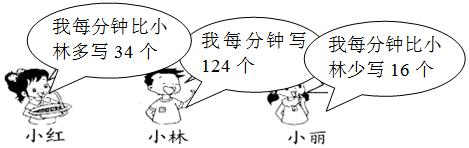

# Mathematics (Grade 6)

**ID**: dd4866a9
**难度**: medium_hard
**题型**: short_answer

## 题目
写字比赛．

他们5分钟各写多少个字？

## 解答

**答案**: 790, 620, 540

1. Step1:先计算小红每分钟写字个数，因为小红每分钟比小林多写34个，小林每分钟写124个，所以小红每分钟写124 + 34 = 158个
2. Step2:计算小红5分钟写字个数，用小红每分钟写字个数乘5，即158×5 = 790个
3. Step3:计算小林5分钟写字个数，小林每分钟写124个，乘5可得124×5 = 620个
4. Step4:计算小丽每分钟写字个数，因为小丽每分钟比小林少写16个，小林每分钟写124个，所以小丽每分钟写124 - 16 = 108个
5. Step5:计算小丽5分钟写字个数，用小丽每分钟写字个数乘5，即108×5 = 540个

## 知识点

**知识点**:
  - 简单的工程问题

---
