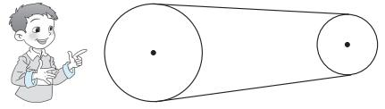

# Mathematics (Grade 6)

**ID**: df123e13
**难度**: medium_hard
**题型**: short_answer

## 题目
如图，两个连在一起的皮带轮，已知小轮的半径是3分米，当这个小轮转3周时，大轮正好转一周，求这个大轮的半径是多少？

## 解答

**答案**: 9

1. Step1:根据圆的周长公式C = 2πr（其中C为周长，r为半径，π取3.14），计算小轮的周长，即2×3.14×3 = 18.84分米
2. Step2:因为小轮转3周时大轮正好转一周，所以大轮的周长是小轮周长的3倍，可得大轮周长为18.84×3 = 56.52分米
3. Step3:根据圆的周长公式C = 2πr，已知大轮周长C = 56.52分米，π = 3.14，可得大轮半径r = 56.52÷3.14÷2 = 9分米

## 知识点

**知识点**:
  - 圆的周长

---
