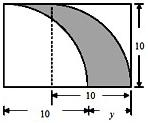

# Mathematics (Grade 6)

**ID**: df4405bf
**难度**: medium_hard
**题型**: short_answer

## 题目
圆中的弧线的半径均为10，且阴影部份占长方形的$\frac{9}{29}$，求y的值？

## 解答

**答案**: 4.5

1. Step1:计算大长方形的面积为10*(10 + y)
2. Step2:计算大长方形中两块白的面积和为10*10 = 100
3. Step3:因为阴影部份占长方形的9/29，所以两块白的面积和占长方形的1 - 9/29 = 20/29
4. Step4:根据两块白的面积和与长方形面积的关系列出方程10*(10 + y) = 100 / (20/29)
5. Step5:化简方程10*(10 + y) = 100 * 29/20得到100 + 10y = 145
6. Step6:求解方程100 + 10y = 145，得出y = (145 - 100) / 10 = 4.5

## 知识点

**知识点**:
  - 组合图形的面积．

---
