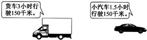

# Mathematics (Grade 6)

**ID**: dfc0900a
**难度**: medium_hard
**题型**: short_answer

## 题目
（1）如图，写出小汽车与货车行驶时间的比，并化简；写出小汽车与货车的速度比，并化简．
（2）你发现了什么？

## 解答

**答案**: 1：2, 2：1, 相反的比

1. Step1:求小汽车与货车行驶时间的比，即1.5:3，将其化为整数比为15:30，再化简得到1:2
2. Step2:先分别计算小汽车速度为150÷1.5 = 100，货车速度为150÷3 = 50，然后求小汽车与货车的速度比为100:50，化简得到2:1
3. Step3:对比前面得到的小汽车与货车行驶时间的比1:2和速度比2:1，发现它们是相反的比

## 知识点

**知识点**:
  - 比的应用；求比值和化简比．

---
