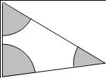

# Mathematics (Grade 6)

**ID**: e06b128c
**难度**: medium_hard
**题型**: short_answer

## 题目
求阴影部分的面积（单位：厘米）如图每个扇形的半径都是2厘米．

## 解答

**答案**: 6.28

1. Step1:明确三角形内角和为180°，且三个扇形半径均为2厘米
2. Step2:根据上述条件得出通过图形组合可将阴影部分组成一个半径为2厘米的半圆
3. Step3:根据半圆面积公式S = 3.14×r²÷2（r为半径），计算半圆面积，即3.14×2²÷2
4. Step4:先计算2² = 4，再计算3.14×4 = 12.56，最后计算12.56÷2 = 6.28，得出阴影部分面积为6.28平方厘米

## 知识点

**知识点**:
  - 组合图形的面积

---
