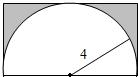

# Mathematics (Grade 6)

**ID**: e0a014bb
**难度**: medium_hard
**题型**: short_answer

## 题目
求阴影部分面积（单位：厘米）

## 解答

**答案**: 6.88

1. Step1:根据半径与直径的关系，计算长方形的长为4×2 = 8厘米
2. Step2:根据长方形面积公式，计算长方形面积为8×4 = 32平方厘米
3. Step3:根据半圆面积公式，计算半圆面积为3.14×4²÷2 = 25.12平方厘米
4. Step4:用长方形面积减去半圆面积，得到阴影部分面积为32 - 25.12 = 6.88平方厘米

## 知识点

**知识点**:
  - 圆、圆环的面积；长方形、正方形的面积．

---
