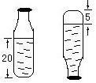

# Mathematics (Grade 6)

**ID**: e0ed3285
**难度**: medium_hard
**题型**: short_answer

## 题目
如图，饮料瓶的容积是300毫升，正放时饮料的高度为20厘米，倒放时瓶内空余部分的高度为5厘米，求瓶内有饮料多少毫升？

## 解答

**答案**: 240

1. Step1:分析得出左图中20厘米高的饮料以上至瓶口部分的容积相当于右图中上面5厘米高的那部分的容积
2. Step2:计算饮料体积占饮料瓶容积的比例，即20÷（20 + 5）= 20÷25 = $\frac{4}{5}$
3. Step3:已知饮料瓶容积是300毫升，根据一个数乘分数的意义，用饮料瓶容积乘以饮料体积占比，即300×$\frac{4}{5}$ = 240（毫升）

## 知识点

**知识点**:
  - 圆柱的侧面积、表面积和体积

---
