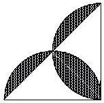

# Mathematics (Grade 6)

**ID**: e104dc7f
**难度**: medium_hard
**题型**: short_answer

## 题目
已知图中是边长为4厘米的等腰直角三角形．求阴影部分的面积．

## 解答

**答案**: 4.56

1. Step1:明确等腰直角三角形的边长为4厘米
2. Step2:计算以4厘米为直径的圆的半径，即4÷2 = 2厘米
3. Step3:根据圆的面积公式S = πr²，计算圆的面积为3.14×2² = 3.14×4 = 12.56平方厘米
4. Step4:根据三角形面积公式S = 底×高÷2，计算等腰直角三角形的面积为4×4÷2 = 8平方厘米
5. Step5:用圆的面积减去等腰直角三角形的面积，即12.56 - 8 = 4.56平方厘米，得到阴影部分面积

## 知识点

**知识点**:
  - 组合图形的面积．

---
