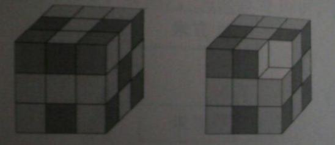

# Mathematics (Grade 6)

**ID**: e30cc110
**难度**: medium_hard
**题型**: short_answer

## 题目
下面两个魔方的表面积一样吗？为什么？

## 解答

**答案**: 一样, 因为凸出来的面积和凹进去的面积是一样多的。

1. Step1:观察两个魔方，发现只有右边的面积有差别
2. Step2:分析图一右边的面积，得出是3个小正方形的面积和
3. Step3:分析图二右边的面积，得出是3个小正方形的面积和
4. Step4:对比两个魔方右边的面积，发现二者相等
5. Step5:得出结论，两个魔方的表面积一样，原因是凸出来的面积和凹进去的面积一样多

## 知识点

**知识点**:
  - --

---
