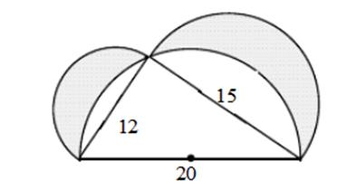

# Mathematics (Grade 6)

**ID**: e665463d
**难度**: medium_hard
**题型**: short_answer

## 题目
如图所示，两个阴影部分面积的和是多少平方厘米。

## 解答

**答案**: 65.635

1. Step1:计算直径为12的半圆的半径，12÷2 = 6
2. Step2:根据圆的面积公式S = πr²，计算直径为12的半圆的面积，3.14×6²÷2 = 3.14×36÷2 = 56.52
3. Step3:计算直径为15的半圆的半径，15÷2 = 7.5
4. Step4:根据圆的面积公式S = πr²，计算直径为15的半圆的面积，3.14×7.5²÷2 = 3.14×56.25÷2 = 88.3125
5. Step5:计算直角三角形的面积，根据三角形面积公式S = 1/2×底×高，1/2×12×15 = 90
6. Step6:计算直径为20的半圆的半径，20÷2 = 10
7. Step7:根据圆的面积公式S = πr²，计算直径为20的半圆的面积，3.14×10²÷2 = 3.14×100÷2 = 157
8. Step8:根据阴影部分面积=直径为12的半圆面积+直径为15的半圆面积+直角三角形的面积-直径为20的半圆面积，计算阴影部分面积，56.52 + 88.3125 + 90 - 157 = 65.635

## 知识点

**知识点**:
  - 组合图形的面积

---
