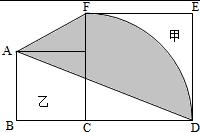

# Mathematics (Grade 6)

**ID**: e73e0158
**难度**: medium_hard
**题型**: short_answer

## 题目
求阴影部分的面积．
如图：甲、乙是正方形，CD为12厘米，AB为10厘米，求阴影部分的面积．

## 解答

**答案**: 113.04

1. Step1:明确阴影部分面积的等量关系为阴影部分的面积=梯形ABCF的面积+扇形FCD的面积-三角形ABD的面积
2. Step2:计算梯形ABCF的面积，上底AB为10厘米，下底FC等于CD为12厘米，高BC等于AB为10厘米，根据梯形面积公式可得(10 + 12)×10÷2 = 22×10÷2 = 110平方厘米
3. Step3:计算扇形FCD的面积，半径CD为12厘米，根据扇形面积公式可得$\frac{1}{4}$×3.14×12² = $\frac{1}{4}$×3.14×144 = 113.04平方厘米
4. Step4:计算三角形ABD的面积，底BD为(10 + 12)厘米，高AB为10厘米，根据三角形面积公式可得(10 + 12)×10÷2 = 22×10÷2 = 110平方厘米
5. Step5:将梯形、扇形、三角形的面积代入等量关系，可得阴影部分面积为110 + 113.04 - 110 = 113.04平方厘米

## 知识点

**知识点**:
  - 组合图形的面积．

---
