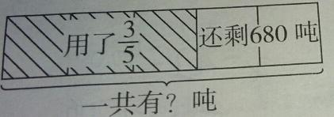

# Mathematics (Grade 6)

**ID**: e82cb5f5
**难度**: medium_hard
**题型**: short_answer

## 题目
看图列出方程并解答。

 用了
 $\frac{3}{5}$
  还剩680吨    一共有？吨

## 解答

**答案**: 1700

1. Step1:设一共有x吨
2. Step2:因为用了\(rac{3}{5}\)，所以剩下的占比为\(1 - rac{3}{5}\)，剩下的吨数为680吨，可列出方程\((1 - rac{3}{5})x = 680\)
3. Step3:化简方程\((1 - rac{3}{5})x = 680\)，得到\(rac{2}{5}x = 680\)
4. Step4:求解方程\(rac{2}{5}x = 680\)，两边同时除以\(rac{2}{5}\)，即\(x = 680\divrac{2}{5}=680	imesrac{5}{2}=1700\)

## 知识点

**知识点**:
  - --

---
