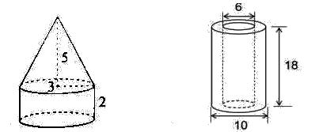

# Mathematics (Grade 6)

**ID**: e8a62b39
**难度**: medium_hard
**题型**: short_answer

## 题目
求下面图形的体积（结果保留π）

## 解答

**答案**: 33π, 288π

1. Step1:对于第一个图形，先计算圆柱体积，根据圆柱体积公式V = πr²h，其中r = 3，h = 2，可得V圆柱 = π×3²×2 = 18π
2. Step2:再计算圆锥体积，根据圆锥体积公式V = 1/3πr²h，其中r = 3，h = 5，可得V圆锥 = π×3²×5÷3 = 15π
3. Step3:第一个图形体积为圆柱体积与圆锥体积之和，即V1 = 18π + 15π = 33π
4. Step4:对于第二个图形，先计算外圆半径R = 10÷2 = 5，内圆半径r = 6÷2 = 3
5. Step5:计算底面圆环面积，根据圆环面积公式S = π(R² - r²)，可得S = π×(5² - 3²) = 16π
6. Step6:根据圆柱体积公式V = Sh，其中S为圆环面积，h = 18，可得第二个图形体积V2 = 16π×18 = 288π

## 知识点

**知识点**:
  - 

---
