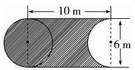

# Mathematics (Grade 6)

**ID**: ec1d27a6
**难度**: medium_hard
**题型**: short_answer

## 题目
一个花坛的形状是如图所示的阴影部分，它的面积是多少？

## 解答

**答案**: 60

1. Step1:观察图形，发现可用割补法，把左边以6为直径的阴影半圆割补到右边以6为直径的半圆空白处
2. Step2:经过割补后，确定阴影部分的面积等于长为10米、宽为6米的长方形的面积
3. Step3:根据长方形面积公式，长方形面积=长×宽，这里长是10米，宽是6米，计算10×6=60平方米
4. Step4:得出阴影部分面积为60平方米

## 知识点

**知识点**:
  - 割补法求组合图形的面积(奥数)

---
