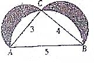

# Mathematics (Grade 6)

**ID**: ec46413d
**难度**: medium_hard
**题型**: short_answer

## 题目
求阴影部分的面积．（单位：厘米）

## 解答

**答案**: 6

1. Step1:先求直径为5厘米的半圆面积减去直角边为3厘米、4厘米的三角形的面积，即3.14×（5÷2）**2÷2 - 3×4÷2 = 9.8125 - 6 = 3.8125平方厘米，此为空白处左上方和右上方两部分面积的差
2. Step2:再求直径为3厘米的半圆面积，即3.14×（3÷2）**2÷2 = 3.5325平方厘米
3. Step3:接着求直径为4厘米的半圆面积，即3.14×（4÷2）**2÷2 = 6.28平方厘米
4. Step4:最后用直径为3厘米、4厘米的两个半圆面积之和减去上述两部分面积的差，即3.5325 + 6.28 - 3.8125 = 6平方厘米，得到阴影部分面积

## 知识点

**知识点**:
  - 组合图形的面积

---
