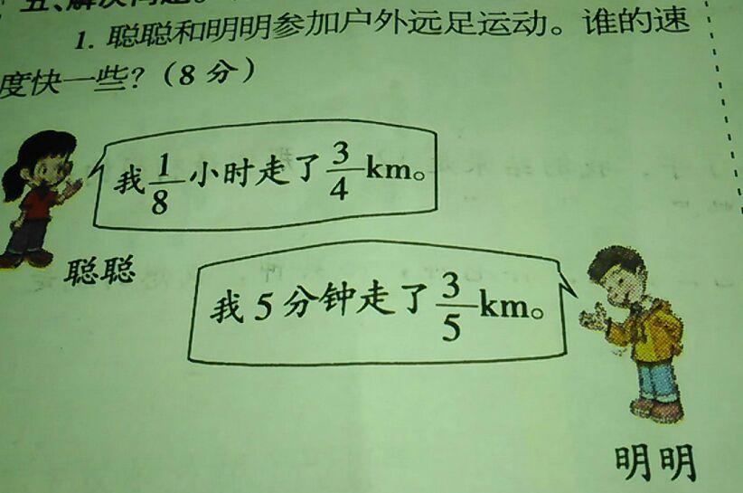

# Mathematics (Grade 6)

**ID**: efd5ad94
**难度**: medium_hard
**题型**: short_answer

## 题目
聪聪和明明参加户外远足活动。谁的速度快一些？
 聪聪：我
 $\frac{1}{8}$
  小时走了
  $\frac{3}{4}$
   km。
 明明：我5分钟走了
 $\frac{3}{5}$
  km。

## 解答

**答案**: 明明

1. Step1:将聪聪所用时间$\frac{1}{8}$小时换算为分钟，即$\frac{1}{8}×60 = 7.5$分钟
2. Step2:计算聪聪的速度，根据速度=路程÷时间，可得$\frac{3}{4}÷7.5 = 0.1$千米/分钟
3. Step3:计算明明的速度，根据速度=路程÷时间，可得$\frac{3}{5}÷5 = 0.12$千米/分钟
4. Step4:比较两人速度大小，因为$0.12 > 0.1$，所以明明速度更快，答案为明明

## 知识点

**知识点**:
  - --

---
