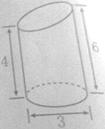

# Mathematics (Grade 6)

**ID**: f11d1f20
**难度**: medium_hard
**题型**: short_answer

## 题目
求图中物体的体积．（单位：cm）

## 解答

**答案**: 35.325

1. Step1:先计算圆柱底面半径，3÷2 = 1.5（cm）
2. Step2:计算圆柱的平均高度，(4 + 6)÷2 = 5（cm）
3. Step3:根据圆柱体积公式V = πr²h，计算体积，3.14×1.5²×5 = 3.14×2.25×5 = 3.14×11.25 = 35.325（立方厘米）

## 知识点

**知识点**:
  - 圆柱的侧面积、表面积和体积

---
