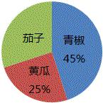

# Mathematics (Grade 6)

**ID**: f55ce679
**难度**: medium_hard
**题型**: short_answer

## 题目

(2008•宝应县)在800平方米的大棚里育有黄瓜、茄子和青椒(如图)，茄子的面积占大棚面积的百分之几？青椒比黄瓜的面积多多少平方米？

## 解答

**答案**: 30%, 160

1. Step1:明确把大棚总面积看成单位'1'，已知黄瓜面积占总面积的25%，青椒面积占总面积的45%，求茄子面积占比，用1 - 25% - 45%，先算1 - 25% = 75%，再算75% - 45% = 30%
2. Step2:求青椒比黄瓜面积多的平方米数，先算青椒比黄瓜面积多的百分比，即45% - 25% = 20%，再用大棚总面积800平方米乘这个百分比，800×20% = 160平方米

## 知识点

**知识点**:
  - 扇形统计图;百分数的实际应用．

---
