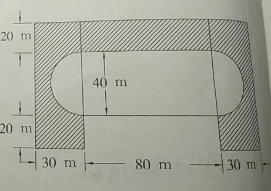

# Mathematics (Grade 6)

**ID**: f63a5b7a
**难度**: medium_hard
**题型**: short_answer

## 题目
我校要在运动场（两头为半圆形）周围种植草坪（如图阴影部分所示），请你计算草坪的面积。

 40m  30m  80m  30m   20m  20m

## 解答

**答案**: 2744m^{2}

1. Step1:计算三个长方形的面积和，其中两个长方形的长为20 + 20 + 40，宽为30，另一个长方形长为80，宽为20，根据长方形面积公式长×宽，可得(20+20+40)×30×2+80×20=80×30×2+80×20=4800 + 1600 = 4000m²
2. Step2:计算两个半圆的面积和，因为两个半圆可拼成一个整圆，圆的直径为40m，半径为40÷2=20m，根据圆的面积公式πr²，可得3.14×(40÷2)²=3.14×400 = 1256m²
3. Step3:用三个长方形的面积和减去两个半圆的面积和得到草坪的面积，即4000 - 1256 = 2744m²

## 知识点

**知识点**:
  - --

---
