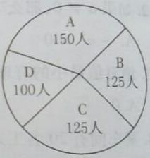

# Mathematics (Grade 6)

**ID**: f7dd8200
**难度**: medium_hard
**题型**: short_answer

## 题目
某学校对该校喜欢体育活动的学生进行一次调查，A表示喜欢足球的学生，B表示喜欢篮球的学生，C表示喜欢排球的学生，D表示喜欢乒乓球的学生，如图所示，扇形区分别表示喜欢该项目的人数，若全校共有学生500人，分别求出喜欢每个项目的人数所占全校人数的百分比．

 A150人 B125人 C125人 D100人

## 解答

**答案**: 30%, 25%, 25%, 20%

1. Step1:计算喜欢足球的人数所占百分比，150÷500×100%=30%
2. Step2:计算喜欢篮球的人数所占百分比，125÷500×100%=25%
3. Step3:计算喜欢排球的人数所占百分比，125÷500×100%=25%
4. Step4:计算喜欢乒乓球的人数所占百分比，100÷500×100%=20%

## 知识点

**知识点**:
  - --

---
