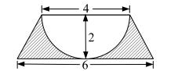

# Mathematics (Grade 6)

**ID**: f8efbd0b
**难度**: medium_hard
**题型**: short_answer

## 题目
求下图阴影部分的面积。（单位：厘米） 

## 解答

**答案**: 3.72

1. Step1:明确图形组成，此图形由梯形和半圆组成，且阴影部分面积 = 梯形面积 - 半圆面积
2. Step2:根据梯形面积公式S=(a + b)h÷2（其中a = 4厘米，b = 6厘米，h = 2厘米），计算梯形面积为(4 + 6)×2÷2 = 10平方厘米
3. Step3:根据半圆面积公式S = 3.14×r²÷2（其中r = 2厘米），计算半圆面积为3.14×2²÷2 = 6.28平方厘米
4. Step4:计算阴影部分面积，用梯形面积减去半圆面积，即10 - 6.28 = 3.72平方厘米

## 知识点

**知识点**:
  - 组合图形的面积;圆的面积;梯形的面积

---
