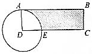

# Mathematics (Grade 6)

**ID**: f91b56b3
**难度**: medium_hard
**题型**: short_answer

## 题目
如图，点D是圆心，长方形ABCD的长是21厘米，阴影部分的周长是54.56厘米，图中圆的周长是多少厘米？

## 解答

**答案**: 50.24

1. Step1:根据解析2可知，先计算阴影部分的周长减去长方形ABCD长的2倍，即54.56 - 21×2 = 54.56 - 42 = 12.56厘米，此结果为圆周长的1/4
2. Step2:因为上一步得到的12.56厘米是圆周长的1/4，所以将12.56乘以4，即12.56×4 = 50.24厘米，得到圆的周长

## 知识点

**知识点**:
  - 圆与组合图形

---
