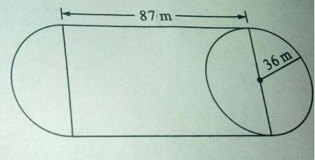

# Mathematics (Grade 6)

**ID**: fbfdd295
**难度**: medium_hard
**题型**: short_answer

## 题目
周山小学田径场如图，如果将这个田径场全部铺上草坪，草坪的成本为每平方米2元，这块田径场的草坪要多少钱？（得数保留整数）

 87m    36m

## 解答

**答案**: 10666.88

1. Step1:计算圆的面积，根据圆的面积公式$S = \pi r^2$，其中$r = 36m$，可得$S_1 = 3.14×36^{2}=3.14×1296 = 4069.44$平方米
2. Step2:计算长方形的面积，长方形的长为87m，宽为$36×2 = 72m$，根据长方形面积公式$S = a×b$，可得$S_2 = 36×2×87 = 72×87 = 6264$平方米
3. Step3:计算田径场的总面积，即圆的面积与长方形面积之和，$S = S_1 + S_2 = 4069.44 + 6264 = 10333.44$平方米
4. Step4:计算草坪的总费用，已知每平方米成本为2元，所以总费用$C = 10333.44×2 = 10666.88$元

## 知识点

**知识点**:
  - --

---
