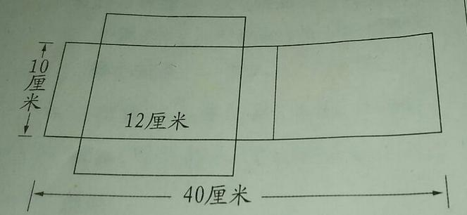

# Mathematics (Grade 6)

**ID**: fe3575d2
**难度**: medium_hard
**题型**: short_answer

## 题目
下图是一个长方体纸盒的平面展开图，这个纸盒的体积是多少？

 10厘米，12厘米，40厘米.

## 解答

**答案**: 960

1. Step1:计算长方体纸盒的高，根据公式(40 - 12×2)÷2，先算乘法12×2=24，再算减法40 - 24 = 16，最后算除法16÷2 = 8厘米
2. Step2:确定长方体纸盒的长为12厘米，宽为10厘米
3. Step3:计算长方体纸盒的底面积，根据长方形面积公式，底面积为12×10 = 120平方厘米
4. Step4:根据长方体体积公式，体积为底面积乘以高，即120×8 = 960立方厘米

## 知识点

**知识点**:
  - 

---
