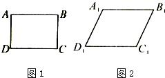

# Mathematics (Grade 6)

**ID**: 0002a99e
**难度**: medium
**题型**: multiple_choice

## 题目
长方形如图1、平行四边形如图2，已知AB=$A_{1}D_{1}$，那么长
方形（  ）平行四边形的面积．
A．大于
B．小于
C．等于
D．无法比较

## 解答

**答案**: B

1. Step1:明确长方形面积公式为长方形面积 = AB×AD
2. Step2:明确平行四边形面积公式为平行四边形面积 = A₁D₁×C₁E
3. Step3:已知AB = A₁D₁
4. Step4:根据图形可知AD＜C₁E
5. Step5:因为长方形面积 = AB×AD，平行四边形面积 = A₁D₁×C₁E，且AB = A₁D₁，AD＜C₁E，所以长方形的面积小于平行四边形的面积，答案选B

## 知识点

**知识点**:
  - 面积及面积的大小比较．

---
