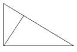

# Mathematics (Grade 6)

**ID**: 023a52bc
**难度**: medium
**题型**: multiple_choice

## 题目
下面的图形中有（ ）个直角

A．1
B．2
C．3

## 解答

**答案**: C

1. Step1:观察图形，大三角形有1个直角，内部小三角形有2个直角。
2. Step2:计算直角总数，1 + 2 = 3个。
3. Step3:对比选项，发现C选项为3，所以答案是C。

## 知识点

**知识点**:
  - 小学数学;图形与几何;平面图形;角

---
