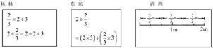

# Mathematics (Grade 6)

**ID**: 04c4f95d
**难度**: medium
**题型**: multiple_choice

## 题目
为了得到$2\div \frac{2}{3}$的结果，下面三位同学用不同的方法表达了自己的想法，想法合理的有（   ）。

$\begin{description}
\item A．林林和东东\item B．林林和西西\item C．东东和西西
\end{description}$

## 解答

**答案**: C

1. Step1:分析林林的想法，$2\div rac{2}{3}$可转化为$2	imesrac{3}{2}$，但林林写成了$2\div 2	imes 3$，这种转化不符合运算法则，想法不合理
2. Step2:分析东东的想法，根据除法运算法则，$2\div rac{2}{3}=2	imesrac{3}{2}=(2	imes 3)\div 2$，东东的想法合理
3. Step3:分析西西的想法，从图形角度看，将长度为2m的线段按每段$rac{2}{3}$m来分，通过图形直观展示了$2\div rac{2}{3}$的意义，想法合理
4. Step4:综合以上分析，东东和西西的想法合理，所以答案选C

## 知识点

**知识点**:
  - 小学数学;数与代数;数的运算;分数的四则运算;分数除法

---
