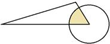

# Mathematics (Grade 6)

**ID**: 05159464
**难度**: medium
**题型**: multiple_choice

## 题目
如图，两个图形重叠部分的面积相当于圆面积的$\frac{1}{6}$，相当于三角形面积的$\frac{1}{4}$。三角形和圆面积的比是（   ）。

A．3:5
B．6:4
C．2:3

## 解答

**答案**: C

1. Step1:设重叠部分的面积为1
2. Step2:因为重叠部分的面积相当于圆面积的$\frac{1}{6}$，所以圆的面积为$1\div\frac{1}{6}=6$
3. Step3:因为重叠部分的面积相当于三角形面积的$\frac{1}{4}$，所以三角形的面积为$1\div\frac{1}{4}=4$
4. Step4:计算三角形和圆面积的比为$4:6 = 2:3$

## 知识点

**知识点**:
  - 小学数学;数与代数;比和比例;比;比值与化简比

---
