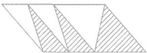

# Mathematics (Grade 6)

**ID**: 090a46fb
**难度**: medium
**题型**: multiple_choice

## 题目
下图平行四边形中空白部分面积小于阴影部分面积．(    )．

## 解答

**答案**: ×

1. Step1:明确平行四边形面积与三角形面积的关系，三角形面积是与它等底等高的平行四边形面积的一半
2. Step2:观察图形，发现三个阴影三角形的底之和等于平行四边形的底，高与平行四边形的高相等，所以三个阴影三角形面积和等于平行四边形面积的一半
3. Step3:同理，三个空白三角形的底之和也等于平行四边形的底，高与平行四边形的高相等，所以三个空白三角形面积和也等于平行四边形面积的一半
4. Step4:得出三个阴影三角形的面积和与三个空白三角形的面积和相等的结论
5. Step5:判断“平行四边形中空白部分面积小于阴影部分面积”这一说法错误，答案为×

## 知识点

**知识点**:
  - 面积及面积的大小比较；平行四边形的面积；三角形的周长和面积．

---
