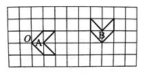

# Mathematics (Grade 6)

**ID**: 0abc77b8
**难度**: medium
**题型**: multiple_choice

## 题目
如下图，图形B是图形A绕点O（   ）旋转90°，再向右平移（   ）格得到的。

①顺时针    ②逆时针    ③5     ④6
$\begin{description}
\item A．①②\item B．②③\item C．②④\item D．①③
\end{description}$

## 解答

**答案**: C

1. Step1:观察图形A和图形B的位置关系，判断图形A绕点O的旋转方向，发现图形B是图形A绕点O逆时针旋转90°得到的，所以第一个空选②
2. Step2:对比图形A旋转后与图形B的位置，数出图形A旋转后向右平移到图形B的格数，得出是向右平移6格，所以第二个空选④
3. Step3:根据前面两个空的选择，确定答案为选项C

## 知识点

**知识点**:
  - 小学数学;图形与几何;图形与变换;平移与平移现象;旋转三要素及旋转图形

---
