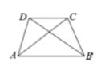

# Mathematics (Grade 6)

**ID**: 0d15c716
**难度**: medium
**题型**: multiple_choice

## 题目
下图中三角形ABC的面积与三角形ADB的面积相比，（    ）．

$\begin{description}
\item A．三角形ABC的面积大\item B．三角形ADB的面积大\item C．两者一样大
\end{description}$

## 解答

**答案**: C

1. Step1:观察图形可知，三角形ABC和三角形ADB有共同的底AB。
2. Step2:这两个三角形的高都是从点D和点C向AB边作垂线，两条垂线的长度相等，即这两个三角形等高。
3. Step3:根据三角形面积公式S = 1/2×底×高，因为底相同且高相同，所以它们的面积相等。

## 知识点

**知识点**:
  - 小学数学;图形与几何;平面图形;三角形;三角形的面积

---
