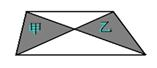

# Mathematics (Grade 6)

**ID**: 0ead561b
**难度**: medium
**题型**: multiple_choice

## 题目
在梯形中（如图），三角形甲的面积和三角形乙的面积相比（    ）。

$\begin{description}
\item A．甲＞乙\item B．甲＜乙\item C．甲＝乙\item D．无法比较
\end{description}$

## 解答

**答案**: C

1. Step1:观察图形，发现三角形甲和三角形乙分别加上它们中间的空白三角形后，可组成两个新的三角形。
2. Step2:这两个新三角形是等底等高的，因为它们都在梯形内，底是梯形的下底，高是梯形的高。
3. Step3:根据三角形面积公式S = 1/2ah（a为底，h为高），等底等高的三角形面积相等，所以这两个新三角形面积相等。
4. Step4:由于这两个新三角形分别减去中间相同的空白三角形后，就得到三角形甲和三角形乙，所以三角形甲和三角形乙的面积相等，答案选C。

## 知识点

**知识点**:
  - 

---
