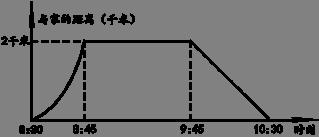

# Mathematics (Grade 6)

**ID**: 0f4e0d9f
**难度**: medium
**题型**: multiple_choice

## 题目
下图是丁小乖去图书馆的折线统计图，他在（      ）区间内，走的路程与时间成正比例关系。

$\begin{description}
\item A．8:30～8:45\item B．8:45～9:45\item C．9:45～10:30\item D．以上答案都不正确
\end{description}$

## 解答

**答案**: C

1. Step1:明确正比例关系的特点，两种相关联的量，一种量变化，另一种量也随着变化，如果这两种量中相对应的两个数比值（也就是商）一定，这两种量就叫做成正比例的量，它们的关系叫做正比例关系，在路程 - 时间图像中表现为一条过原点的直线。
2. Step2:分析A选项8:30～8:45，此区间图像是曲线，不是直线，路程与时间不成正比例关系。
3. Step3:分析B选项8:45～9:45，此区间路程不变，说明处于静止状态，路程与时间不成正比例关系。
4. Step4:分析C选项9:45～10:30，此区间图像是一条直线，说明速度一定，也就是路程和时间的比值一定，路程与时间成正比例关系。
5. Step5:综上，答案选C。

## 知识点

**知识点**:
  - 小学数学;数与代数;比和比例;比例;统计和概率;统计;统计图;单式折线统计图

---
