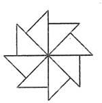

# Mathematics (Grade 6)

**ID**: 0fcbacd2
**难度**: medium
**题型**: multiple_choice

## 题目
下图可以看作是一个等腰直角三角形旋转若干次而形成的，每次旋转的度数至少是（  ）。

$\begin{description}
\item A．90°\item B．60°\item C．45°\item D．30°
\end{description}$

## 解答

**答案**: C

1. Step1:观察图形可知，该图形是由一个等腰直角三角形绕着一个点旋转形成的，且旋转后形成了8个相同的等腰直角三角形部分。
2. Step2:因为一个周角是360°，图形由8个相同部分组成，所以用周角的度数除以相同部分的数量，即360°÷8 = 45°，得到每次旋转的最小度数。
3. Step3:对比选项，发现45°符合选项C。

## 知识点

**知识点**:
  - 

---
