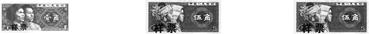

# Mathematics (Grade 6)

**ID**: 102fc713
**难度**: medium
**题型**: multiple_choice

## 题目
用下面的钱买一个1元1角的毽子（   ）。

A．够
B．不够
C．无法确定够不够

## 解答

**答案**: A

1. Step1:观察图片可知，有3张1元纸币，总共是3元
2. Step2:毽子价格是1元1角
3. Step3:比较3元与1元1角的大小，3元大于1元1角
4. Step4:得出结论，用这些钱买毽子够，答案选A

## 知识点

**知识点**:
  - 小学数学;数与代数;常见的量;人民币单位及换算

---
