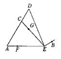

# Mathematics (Grade 6)

**ID**: 105ef4a0
**难度**: medium
**题型**: multiple_choice

## 题目
如图所示，从A地到达B地，最短的路线是（ ）．

$\begin{description}
\item A．A→C→E→B\item B．A→F→E→B\item C．A→D→E→B\item D．A→C→G→E→B
\end{description}$

## 解答

**答案**: B

1. Step1:根据两点之间线段最短的原理，在从A地到B地的路径中，A到E之间的最短路线是线段AE，在给出的选项中，A→F→E这条路线中AFE近似为线段AE。
2. Step2:E到B是固定的路径，所以综合来看，A→F→E→B这条路线相对其他选项是最短的。
3. Step3:对比选项A、C、D，其中的A→C→E、A→D→E、A→C→G→E相对A→F→E都不是更短的路线，所以答案是A→F→E→B，即选项B。

## 知识点

**知识点**:
  - 

---
