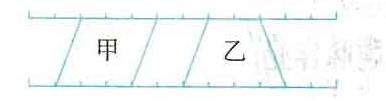

# Mathematics (Grade 6)

**ID**: 11912251
**难度**: medium
**题型**: multiple_choice

## 题目
下图中，甲、乙两图的面积相比（    ）

   A．甲＝乙
   B．甲＜乙
   C．甲＞乙

## 解答

**答案**: A

1. Step1:明确甲是平行四边形，其面积计算公式为面积=底×高
2. Step2:明确乙是梯形，其面积计算公式为面积=（上底+下底）×高÷2
3. Step3:观察图形得出甲的底为3
4. Step4:计算乙中(2+4)÷2=3
5. Step5:发现甲和乙的高相同
6. Step6:根据前面得出的甲、乙的底和高的关系，依据面积公式判断出二者面积相同，所以答案选A

## 知识点

**知识点**:
  - 总复习-
-

---
