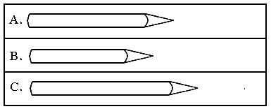

# Mathematics (Grade 6)

**ID**: 146472ff
**难度**: medium
**题型**: multiple_choice

## 题目
最长的铅笔是：（  ） 

$\begin{description}
\item A．A\item B．B\item C．C
\end{description}$

## 解答

**答案**: C

1. Step1:观察图片中A铅笔的长度
2. Step2:观察图片中B铅笔的长度
3. Step3:观察图片中C铅笔的长度
4. Step4:比较A、B、C三支铅笔的长度
5. Step5:得出C铅笔最长的结论

## 知识点

**知识点**:
  - 小学数学;统计和概率;统计

---
