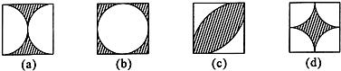

# Mathematics (Grade 6)

**ID**: 16f0dd9b
**难度**: medium
**题型**: multiple_choice

## 题目
如图，下面4个正方形的边长都相等，共中阴影部分的面积相等的图形有（  ）

A．0个
B．2个
C．3个
D．4个

## 解答

**答案**: C

1. Step1:观察图形可知四个正方形边长都相等，所以四个正方形全等且面积相等
2. Step2:分析图形（a）、（b）、（d），发现其空白处均可组成一个完整的圆，且这三个圆半径相等，所以这三个圆面积相等
3. Step3:根据等量减去等量差相等的原理，用正方形面积减去空白处圆的面积得到阴影部分面积，由于正方形面积相等，空白处圆面积也相等，所以（a）、（b）、（d）这三个图形中阴影部分的面积相等
4. Step4:得出阴影部分面积相等的图形有3个，答案选C

## 知识点

**知识点**:
  - 面积及面积的大小比较；组合图形的面积．

---
