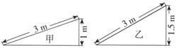

# Mathematics (Grade 6)

**ID**: 1766a5c2
**难度**: medium
**题型**: multiple_choice

## 题目
如图，工人师傅用两块3m长的木板分别搭了两个斜坡。图中(    )斜坡陡一些。

$\begin{description}
\item A．甲\item B．乙\item C．一样陡\item D．无法判断
\end{description}$

## 解答

**答案**: B

1. Step1:明确判断斜坡陡缓的方法，在木板长度相同的情况下，高度越高斜坡越陡
2. Step2:观察图可知甲斜坡高度小于乙斜坡高度
3. Step3:因为两块木板长度都是3m且乙斜坡高度更高，所以乙斜坡陡一些，答案选B

## 知识点

**知识点**:
  - 小学数学;数与代数;比和比例;比;比的应用

---
